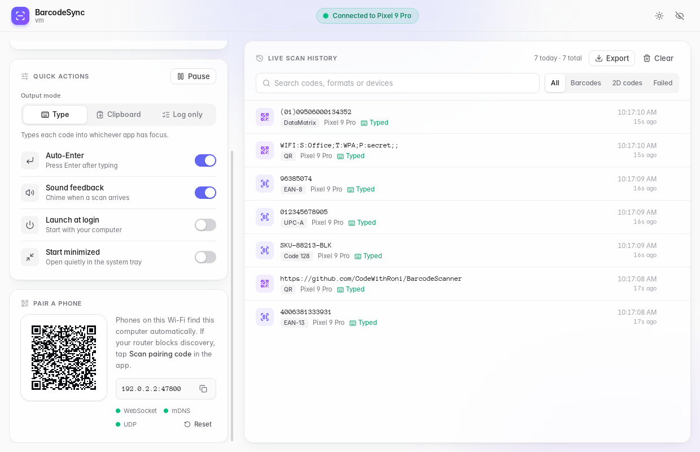
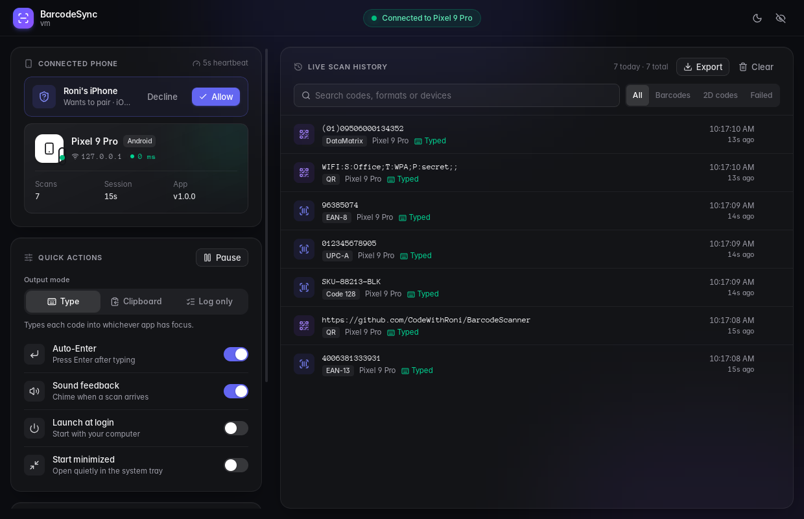

# BarcodeSync

Turn your phone into a wireless barcode & QR scanner for your computer. Point your phone's camera at a barcode and the code is typed straight into whatever app is focused on your computer, copied to the clipboard, or just logged. Both devices only need to be on the same Wi-Fi.

| Light | Dark |
| --- | --- |
|  |  |

## What's in this repo

```
.
├── desktop-app/                  # Tauri v2 desktop app (Windows, macOS, Linux)
│   ├── src/                      # React + TypeScript + Tailwind dashboard
│   │   ├── components/           # Header, DevicesCard, QuickSettings, PairingCard, ScanHistory, Toasts
│   │   ├── hooks/                # useBackend (state + events), useTheme (light/dark/system)
│   │   └── lib/                  # typed API bridge, types, sound, formatting
│   └── src-tauri/
│       ├── Cargo.toml
│       ├── tauri.conf.json
│       ├── capabilities/default.json
│       └── src/
│           ├── lib.rs            # app bootstrap, plugins, window lifecycle
│           ├── protocol.rs       # typed JSON wire protocol
│           ├── state.rs          # persisted config, live sessions, history, snapshot
│           ├── server.rs         # WebSocket server, pairing, heartbeat, scan handling
│           ├── discovery.rs      # mDNS advertisement + UDP broadcast responder
│           ├── injector.rs       # keyboard emulation / clipboard / log-only output
│           ├── tray.rs           # system tray, hide-to-tray, pause
│           └── commands.rs       # commands called by the dashboard
├── mobile-app/                   # Flutter app (Android, iOS)
│   ├── lib/
│   │   ├── main.dart
│   │   └── src/
│   │       ├── core/             # protocol, models, storage, device identity
│   │       ├── services/         # discovery, connection, feedback, app controller
│   │       └── ui/               # theme, widgets, home, scanner, settings
│   ├── android/                  # manifest, build.gradle.kts (release signing), launcher icons
│   ├── ios/                      # Info.plist (camera, local network, Bonjour), Podfile, app icon
│   ├── assets/sounds/            # confirmation sounds
│   └── test/
└── .github/workflows/
    ├── build-desktop.yml         # .exe/.msi, universal .dmg, .deb/.AppImage
    └── build-mobile.yml          # .apk and .ipa (unsigned or signed)
```

## How it works

1. **Discovery.** The desktop advertises `_barcodesync._tcp.local.` over mDNS and answers UDP `discover` broadcasts on port `47810`. The phone uses both, so the computer shows up on the phone and the phone shows up as "nearby" on the computer.
2. **Pairing.** The first time a phone connects, the desktop shows an **Allow / Decline** prompt. Once allowed, the phone stores a pairing token and reconnects silently from then on. Scanning the **pairing QR code** on the dashboard pairs instantly and works even when the router blocks discovery (AP isolation). You can also type the address shown on the dashboard.
3. **Session.** A WebSocket (`ws://<desktop-ip>:47800`) carries a typed JSON protocol. Both sides send a `ping` every 5 seconds. The phone reconnects with exponential back-off (0.5 s → 15 s), immediately when the app returns to the foreground, and as soon as discovery sees the computer again.
4. **Delivery.** Each scan has a `messageId`. The desktop types, copies or logs it and replies with an `ack`, which triggers the phone's haptic and sound confirmation. Scans made while offline are queued on the phone and replayed after reconnecting. The desktop drops duplicates by `messageId`, so nothing is typed twice.

### Protocol

| Frame | Direction | Fields |
| --- | --- | --- |
| `discover` (UDP) | phone → desktop | `deviceId`, `deviceName`, `platform`, `appVersion` |
| `announce` (UDP) | desktop → phone | `deviceId`, `deviceName`, `platform`, `appVersion`, `protocolVersion`, `port`, `ips` |
| `handshake` | phone → desktop | `deviceId`, `deviceName`, `platform`, `appVersion`, `pairingToken?` |
| `handshake_ack` | desktop → phone | `status` (`accepted`/`pending`/`rejected`), `deviceId`, `deviceName`, `platform`, `appVersion`, `protocolVersion`, `paused`, `pairingToken?`, `reason?` |
| `scan` | phone → desktop | `messageId`, `code`, `format`, `timestamp` |
| `ack` | desktop → phone | `messageId`, `status` (`ok`/`duplicate`/`paused`/`unauthorized`/`error`), `detail?` |
| `ping` / `pong` | both | `timestamp` (echoed, used for latency) |
| `status` | desktop → phone | `paused` |
| `bye` | phone → desktop | — |

## Desktop app

**Features:** live connection status, connected-phone card (name, OS, IP, latency/heartbeat, session stats), pairing requests, nearby phones, output mode (Type / Clipboard / Log only), Auto-Enter, sound feedback, launch at login, start minimized, pairing QR code, searchable and filterable scan history with copy, CSV/JSON/TXT export and clear. Closing or minimizing hides the window to the system tray (Open Dashboard, Status, Pause Scanning, Quit).

**Develop**

```bash
cd desktop-app
npm install
npm run tauri dev
```

Requirements: Node 20+, Rust stable, and the [Tauri prerequisites](https://v2.tauri.app/start/prerequisites/) for your OS. On Debian/Ubuntu:

```bash
sudo apt install libwebkit2gtk-4.1-dev libappindicator3-dev librsvg2-dev patchelf libxdo-dev libssl-dev build-essential
```

**Build installers locally:** `npm run tauri build` (output in `src-tauri/target/release/bundle/`).

**Platform notes**

- **macOS:** typing into other apps needs *System Settings → Privacy & Security → Accessibility* permission for BarcodeSync. macOS asks the first time.
- **Linux:** keyboard emulation uses X11 (XTest via libxdo). On Wayland sessions it works in XWayland apps; use **Clipboard** mode for native Wayland apps.
- **Firewall:** allow BarcodeSync on private networks (TCP 47800, UDP 47810, mDNS 5353) when Windows asks.

Settings, trusted phones and history are stored in the OS config folder (`%APPDATA%\com.codewithroni.barcodesync`, `~/Library/Application Support/com.codewithroni.barcodesync`, `~/.config/com.codewithroni.barcodesync`).

## Mobile app

**Features:** radar-style discovery of computers on the Wi-Fi, paired-computer quick connect, auto-reconnect, approval waiting screen, pairing-QR and manual-address fallback, edge-to-edge scanner with animated reticle and laser, torch and camera switch, scan counter, floating last-scan pill with delivery status, configurable duplicate cooldown (default 1.5 s), haptics and sound on desktop `ack`, offline queue.

Supported formats: EAN-13, EAN-8, UPC-A, UPC-E, Code 128, Code 39, Code 93, ITF, Codabar, QR, DataMatrix, PDF417, Aztec.

**Develop** (Flutter 3.50 or newer):

```bash
cd mobile-app
# One-time: generate the remaining platform scaffolding (Gradle wrapper, Xcode
# project, MainActivity…). Files already in the repo are never overwritten.
flutter create --platforms=android,ios --org com.codewithroni --project-name barcodesync .
flutter pub get
flutter run
```

The phone and computer must be on the same Wi-Fi network. On iOS, accept the **Local Network** prompt the first time.

## CI/CD

Both workflows run on version tags (`v*`) and on manual dispatch. On a tag they attach every installer to the GitHub Release for that tag. A manual run uploads them as workflow artifacts.

```bash
git tag v1.0.0
git push origin v1.0.0
```

The tag version is stamped into all three desktop manifests and into the mobile build name automatically.

| Workflow | Runner | Output |
| --- | --- | --- |
| `build-desktop.yml` | `windows-latest` | `BarcodeSync_x.y.z_x64-setup.exe`, `BarcodeSync_x.y.z_x64_en-US.msi` |
| | `macos-latest` | `BarcodeSync_x.y.z_universal.dmg` (Apple Silicon + Intel) |
| | `ubuntu-22.04` | `BarcodeSync_x.y.z_amd64.deb`, `BarcodeSync_x.y.z_amd64.AppImage` |
| `build-mobile.yml` | `ubuntu-latest` | `BarcodeSync-x.y.z-android.apk` |
| | `macos-latest` | `BarcodeSync-x.y.z-ios-unsigned.ipa`, or `BarcodeSync-x.y.z-ios.ipa` when signing secrets are set |

### Optional secrets

Everything builds without secrets. Add these under *Settings → Secrets and variables → Actions* to sign releases:

| Secret | Used for |
| --- | --- |
| `ANDROID_KEYSTORE_BASE64` | Release keystore (`base64 -w0 upload-keystore.jks`). Without it the APK is signed with the debug key. |
| `ANDROID_KEYSTORE_PASSWORD`, `ANDROID_KEY_ALIAS`, `ANDROID_KEY_PASSWORD` | Keystore credentials |
| `IOS_CERTIFICATE_P12_BASE64`, `IOS_CERTIFICATE_PASSWORD` | Apple distribution (or development) certificate |
| `IOS_PROVISIONING_PROFILE_BASE64` | Provisioning profile for `com.codewithroni.barcodesync` |
| `IOS_TEAM_ID` | Apple Developer team ID |
| `IOS_EXPORT_METHOD` | `ad-hoc` (default), `app-store-connect`, `development` or `enterprise` |
| `APPLE_CERTIFICATE`, `APPLE_CERTIFICATE_PASSWORD`, `APPLE_SIGNING_IDENTITY` | macOS Developer ID signing of the `.dmg` |
| `APPLE_ID`, `APPLE_PASSWORD`, `APPLE_TEAM_ID` | macOS notarization |

An unsigned `.ipa` can't be installed on a stock iPhone as-is. Re-sign it (for example with AltStore or Sideloadly) or add the iOS signing secrets.

## License

MIT
